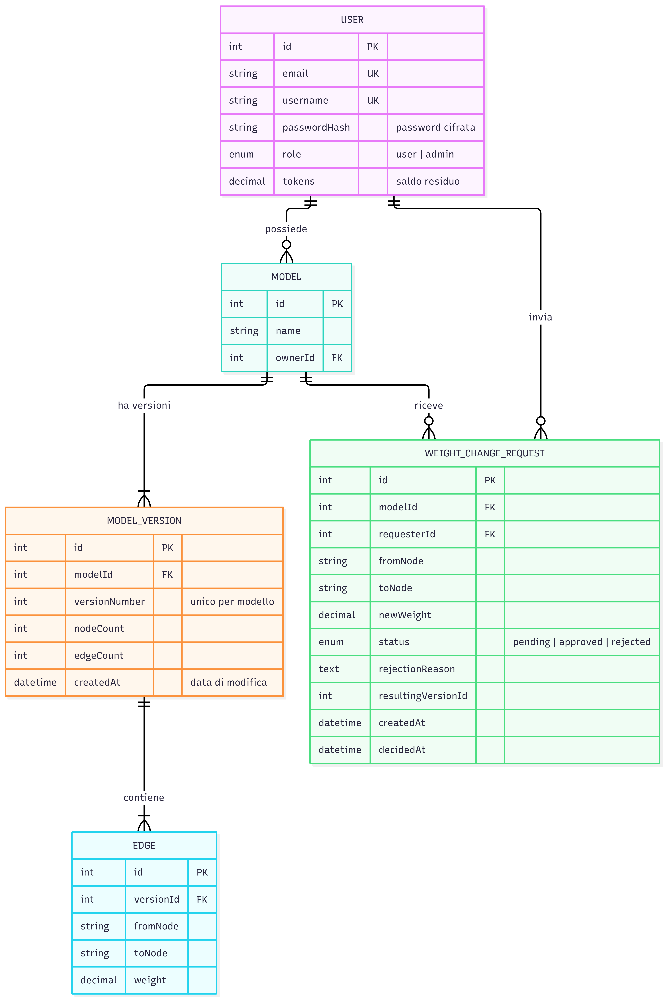
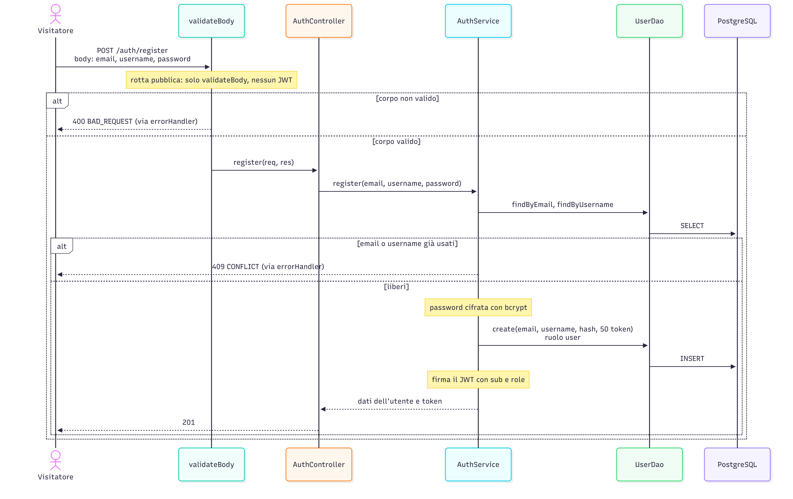
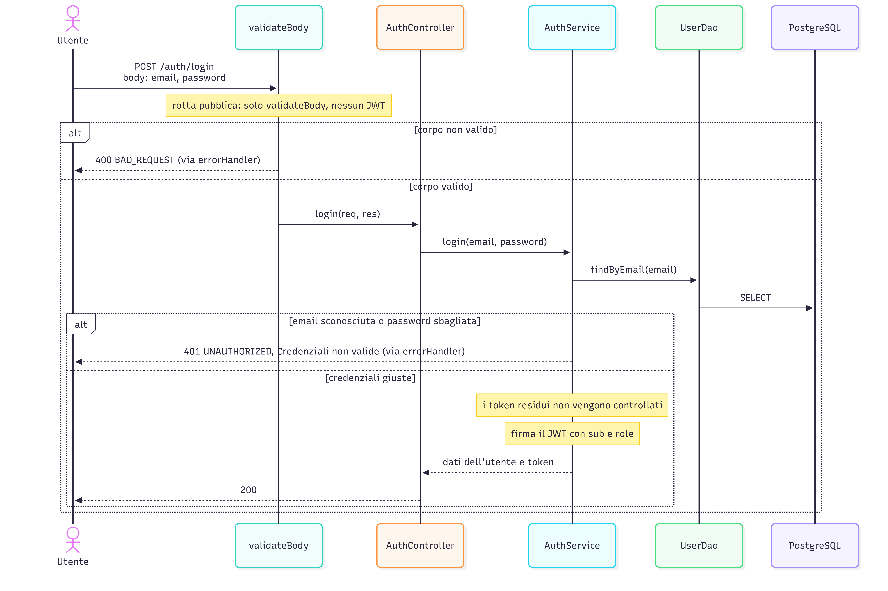
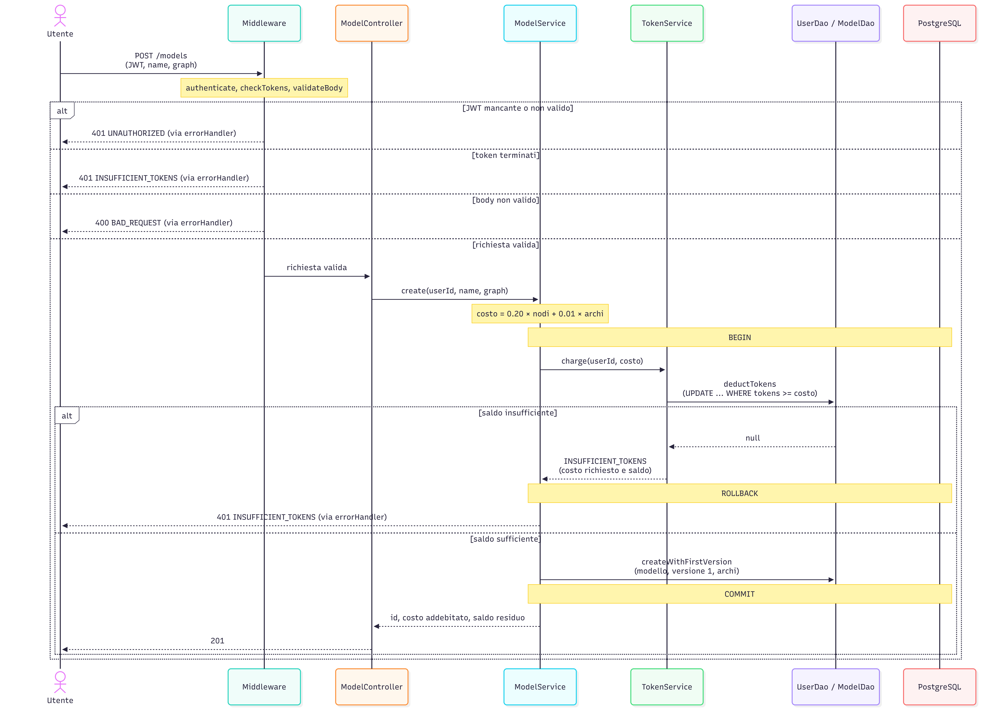
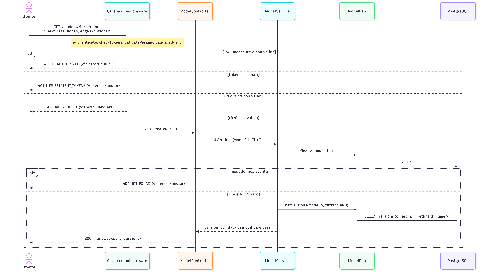
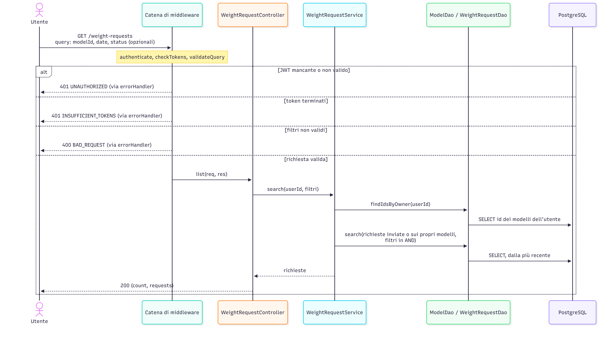
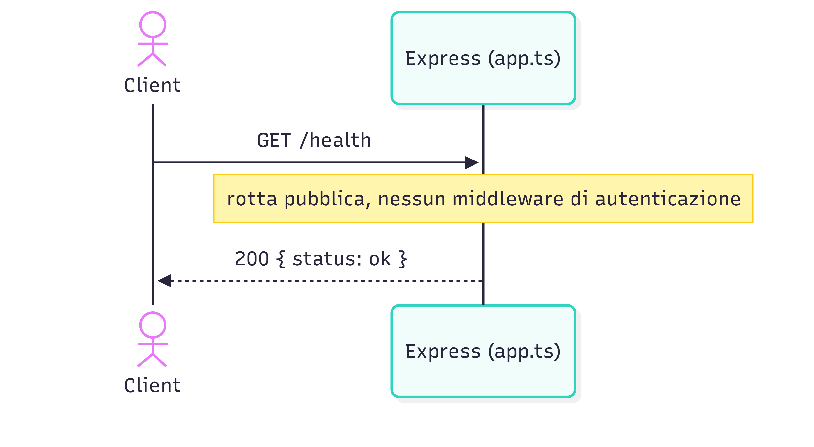
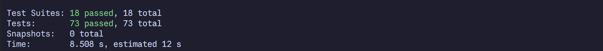
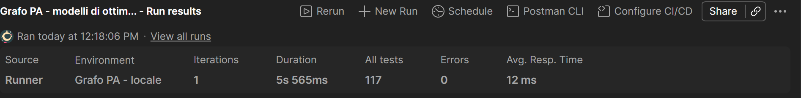

# Backend per modelli di ottimizzazione su grafo

Progetto per l'esame di Programmazione Avanzata (A.A. 2025/2026, UNIVPM).

## Indice

1. [Obiettivo](#obiettivo)
2. [Stack](#stack)
3. [Rotte](#rotte)
4. [Progettazione](#progettazione)
5. [Errori](#errori)
6. [Dati iniziali (seed)](#dati-iniziali-seed)
7. [Avvio con docker-compose](#avvio-con-docker-compose)
8. [Test](#test)
9. [Test con Postman](#test-con-postman)
10. [Struttura del repository](#struttura-del-repository)

## Obiettivo

Il progetto è un back-end REST per creare, eseguire e valutare modelli di ottimizzazione su grafo. Un modello è un grafo con dei pesi sugli archi, e il percorso di costo minimo si calcola con [`node-dijkstra`](https://www.npmjs.com/package/node-dijkstra).

Simula il *crowd-sourcing*: ogni utente autenticato può proporre un nuovo peso per un arco (per esempio i minuti per percorrere un tratto di strada) e il proprietario del modello decide se accettarlo. Se la proposta è approvata il peso si aggiorna con una media esponenziale e nasce una nuova versione dei pesi.

Cosa si può fare:

- creare un modello da un grafo, pagando dei token;
- eseguire un modello e ottenere percorso, costo del percorso e tempo di esecuzione, pagando dei token;
- chiedere il cambio di peso di un arco: la richiesta parte *pending* e poi diventa *approved* o *rejected* (con motivazione);
- consultare lo stato delle richieste e le versioni dei pesi, con dei filtri;
- simulare la variazione del peso di un arco e vedere il risultato migliore;
- ricaricare i token di un utente (solo admin);
- registrarsi e accedere con email e password per ottenere il JWT.

Tutte le rotte, tranne `GET /health`, `POST /auth/register` e `POST /auth/login`, sono protette da JWT RS256.

## Stack

| Componente | Scelta |
|---|---|
| Runtime e linguaggio | Node.js 24, TypeScript `strict` (senza `any`) |
| Web framework | Express 5 |
| ORM e database | Sequelize 6, PostgreSQL 16 (avviato da docker-compose) |
| Grafo | `node-dijkstra` |
| Autenticazione | JWT RS256 (`jsonwebtoken`), password cifrate con `bcryptjs`, chiave privata in `.env` |
| Validazione | `zod` |
| Test | Jest, ts-jest, supertest |
| Contenitori | Docker e docker-compose |
| Collaudo manuale | Postman (collection e ambiente in `postman/`) |

## Rotte

Le rotte non pubbliche vogliono l'header `Authorization: Bearer <JWT>`. A token finiti rispondono tutte 401.

| Metodo e percorso | Chi può chiamarla | Descrizione |
|---|---|---|
| `GET /health` | pubblica | verifica che il servizio sia attivo |
| `POST /auth/register` | pubblica | registra un utente (`{ email, username, password }`), con ruolo `user` e 50 token; risponde con l'utente e il JWT |
| `POST /auth/login` | pubblica | accesso (`{ email, password }`); risponde con l'utente e il JWT |
| `POST /admin/recharge` | admin | ricarica un utente (`{ email, credit }`), il credito si somma al saldo |
| `POST /models` | utente | crea un modello (`{ name, graph }`); costo 0.20 per nodo + 0.01 per arco |
| `POST /models/:id/execute` | utente | esegue il modello (`{ start, goal }`); stesso costo della creazione |
| `POST /models/:id/simulate` | utente | simula la variazione del peso di un arco, senza costo |
| `GET /models/:id/versions` | utente | versioni dei pesi; filtri `date`, `nodes`, `edges` |
| `POST /models/:id/weight-requests` | utente | crea una richiesta di cambio peso (`pending`) |
| `GET /weight-requests` | utente | stato delle richieste; filtri `modelId`, `date`, `status` |
| `PATCH /weight-requests/:id/approve` | proprietario del modello | approva e crea la nuova versione |
| `PATCH /weight-requests/:id/reject` | proprietario del modello | rifiuta, con `{ reason }` obbligatorio |

### Autenticazione

Il JWT si ottiene con `POST /auth/register` o `POST /auth/login`, oppure con `npm run token` (vedi più sotto). Il login funziona anche a token finiti, ma le altre rotte rispondono 401.

Le password sono salvate cifrate (bcrypt) e non compaiono mai nelle risposte. L'admin non si può creare con la registrazione: esiste solo nel seed, e un body con il campo `role` viene rifiutato con 400.

Il JWT contiene solo l'essenziale e dura 1 giorno: `sub` è l'id utente e `role` vale `user` o `admin`.

```json
{ "sub": "2", "role": "user" }
```

### Formato del grafo

Il grafo segue l'interfaccia di `node-dijkstra`: le chiavi sono i nodi e i valori sono i vicini con il peso. È orientato, e ogni vicino deve comparire anche come chiave (anche con `{}`), altrimenti i nodi non si contano bene.

```json
{
  "name": "Casa - Università",
  "graph": {
    "Casa": { "Fermata": 4, "Piazza": 2 },
    "Fermata": { "Piazza": 1, "Università": 5 },
    "Piazza": { "Università": 8 },
    "Università": {}
  }
}
```

Regole: pesi maggiori di 0 e minori di 1000000, al massimo 4 decimali; nessun arco da un nodo a se stesso; almeno un arco; ogni nodo deve avere almeno un arco, perché i nodi di una versione si ricavano dagli archi e un nodo isolato andrebbe perso.

### Esempi di risposta

Esecuzione (`POST /models/1/execute` con `{ "start": "Stazione", "goal": "Collemarino" }`):

```json
{
  "modelId": 1, "versionNumber": 2, "start": "Stazione", "goal": "Collemarino",
  "path": ["Stazione", "Porto", "Piazza Roma", "Duomo", "Passetto", "Montedago", "Collemarino"],
  "cost": 24.1,
  "executionTimeMs": 1.8,
  "tokensCharged": 2.58,
  "remainingTokens": 47.42
}
```

`cost` è la somma dei pesi lungo il percorso, non i token addebitati (quelli sono in `tokensCharged`).

Simulazione (`POST /models/1/simulate`):

```json
{
  "start": "Stazione", "goal": "Collemarino",
  "edge": { "from": "Piazza Roma", "to": "Duomo" },
  "initialWeight": 1, "finalWeight": 2, "step": 0.05
}
```

La risposta ha `results` (peso, percorso e costo per ognuno dei 21 passi), `best` (il risultato col costo minore, con `weights`, cioè tutti i pesi del grafo usati) e `executionTimeMs`.

### Filtri

- `date` è un giorno `YYYY-MM-DD` (UTC): restituisce gli elementi creati in quel giorno. Una data che non esiste (per esempio `2026-02-30`) dà 400.
- `status` vale `pending`, `approved` o `rejected`; `modelId`, `nodes` e `edges` sono interi.
- I filtri sono opzionali e si combinano in AND.

## Progettazione

### Casi d'uso


I ruoli sono due: `user` e `admin`. Il proprietario del modello non è un ruolo ma l'utente che ha creato quel modello, e solo lui può approvare o rifiutare le richieste su quel modello. L'admin fa le stesse cose di un utente (pagando gli stessi token) e in più ricarica i token; sulle richieste degli altri non può decidere.

| Operazione | Utente | Admin | Token addebitati |
|---|---|---|---|
| Creare ed eseguire un modello | sì | sì | sì |
| Simulare, consultare versioni e richieste | sì | sì | no |
| Chiedere il cambio di peso di un arco | sì | sì | no |
| Approvare o rifiutare una richiesta | solo se proprietario | solo se proprietario | no |
| Ricaricare i token di un utente | no (403) | sì | no |
| Registrarsi e accedere | senza JWT | senza JWT | no |

### Modello dei dati



Una **versione dei pesi** è una copia completa del grafo: ogni approvazione crea la versione successiva copiando gli archi e cambiando solo il peso richiesto. Le versioni vecchie restano consultabili. Una richiesta *pending* non tocca il modello, e l'esecuzione usa sempre la versione più recente.

### Diagrammi di sequenza


**Registrazione** (`POST /auth/register`): crea un utente `user` con 50 token e restituisce il JWT. Rotta pubblica. 201, oppure 400 (body non valido, anche con `role`) e 409 (email o username già usati).



**Login** (`POST /auth/login`): controlla email e password e restituisce il JWT. Non guarda i token residui. 200, oppure 400 e 401 (credenziali sbagliate, con lo stesso messaggio).



**Creazione di un modello** (`POST /models`): addebita 0.20 token per nodo e 0.01 per arco e crea il modello, tutto in una transazione. 201, oppure 400 e 401 (JWT non valido, token terminati o insufficienti).



**Esecuzione** (`POST /models/:id/execute`): calcola il percorso minimo sulla versione più recente e addebita lo stesso costo della creazione. 200, oppure 400 (body non valido o nodo sconosciuto), 401, 404 (modello inesistente).


**Approvazione** (`PATCH /weight-requests/:id/approve`): il proprietario approva una richiesta *pending*, il peso si aggiorna con la media esponenziale e nasce una nuova versione. 200, oppure 401, 403 (non proprietario), 404, 409 (richiesta già decisa o arco non più presente).


**Simulazione** (`POST /models/:id/simulate`): fa variare il peso di un arco da un valore iniziale a uno finale con un passo, e restituisce tutti i risultati e il migliore. Non costa token e non modifica il modello. 200, oppure 400 (range, passo o nodi non validi), 401, 404.


**Richiesta di cambio peso e rifiuto** (`POST /models/:id/weight-requests` e `PATCH /weight-requests/:id/reject`): la richiesta nasce *pending* (201); il proprietario può rifiutarla con una motivazione obbligatoria (200). Errori: 400, 401, 403, 404, 409.


**Ricarica dei token** (`POST /admin/recharge`): l'admin somma un credito al saldo di un utente indicato per email. 200, oppure 400, 401, 403 (non admin), 404 (utente inesistente).


**Versioni dei pesi** (`GET /models/:id/versions`): elenca le versioni con gli archi, filtrabili per data, numero di nodi e numero di archi. 200, oppure 400, 401, 404.



**Stato delle richieste** (`GET /weight-requests`): elenca le richieste inviate dall'utente o fatte sui suoi modelli, dalla più recente, filtrabili per modello, data e stato. 200, oppure 400 e 401.



**Verifica del servizio** (`GET /health`): risponde 200 se il servizio è attivo, senza JWT.



### Pattern usati e motivazioni
#### MVC con Service Layer

Le rotte (`src/routes/`) passano la richiesta al controller (`src/controllers/`), che legge i dati già validati, chiama un servizio (`src/services/`) e scrive la risposta JSON, che fa da "view". Costi, media esponenziale, versioni e simulazione stanno nei servizi. I controller restano corti e le regole si provano senza HTTP: `tests/alphaAndBlend.test.ts` lo fa con `blendWeight`.

```ts
// src/controllers/ModelController.ts
export async function create(req: Request, res: Response): Promise<void> {
  const { name, graph } = req.body as { name: string; graph: GraphInput };
  res.status(201).json(await ModelService.create(req.auth.userId, name, graph));
}
```

#### DAO

Le query al database stanno nelle classi di `src/dao/` (`UserDao`, `ModelDao`, `WeightRequestDao`) e non nei servizi. Qui stanno anche le operazioni delicate. L'addebito dei token è una sola `UPDATE ... WHERE tokens >= :amount`: due richieste contemporanee non possono portare il saldo sotto zero. Il `SELECT ... FOR UPDATE` fa passare una alla volta le approvazioni sullo stesso modello.

Le transazioni le aprono i servizi e le passano ai DAO. Nei test i DAO sono mock, quindi il database non serve.

```ts
// src/dao/UserDao.ts
static async deductTokens(userId: number, amount: number, tx?: Transaction): Promise<number | null> {
  const [rows] = await Database.getInstance().query(
    'UPDATE users SET tokens = tokens - :amount WHERE id = :id AND tokens >= :amount RETURNING tokens',
    { replacements: { amount: amount.toFixed(2), id: userId }, transaction: tx },
  );
  const updated = rows as { tokens: string }[];
  return updated.length === 0 ? null : Number(updated[0].tokens);
}
```

#### Chain of Responsibility (la catena dei middleware di Express)

I controlli sulla richiesta sono middleware (`src/middleware/`) messi in catena. Ognuno fa un solo controllo e passa al successivo con `next()`, oppure si ferma con `next(err)`:

- `authenticate` verifica il JWT;
- `checkTokens` controlla che l'utente abbia ancora token;
- `requireRole` limita la rotta a un ruolo;
- `validateBody`, `validateParams` e `validateQuery` validano i dati.

`authenticate` e `checkTokens` sono sul router principale, una volta sola. Ogni rotta aggiunge poi i suoi controlli (solo la ricarica usa `requireRole('admin')`). L'ordine conta: `checkTokens` ha bisogno di sapere chi è l'utente, quindi viene dopo `authenticate`. A token finiti anche l'admin riceve 401.

```ts
// src/routes/index.ts
apiRouter.use(authenticate, checkTokens);
apiRouter.use('/admin', adminRoutes);
```

```ts
// src/routes/adminRoutes.ts
adminRoutes.post('/recharge', requireRole('admin'), validateBody(rechargeSchema), asyncHandler(AdminController.recharge));
```

Controlli di ogni rotta, nell'ordine in cui girano:

| Rotta | Catena |
|---|---|
| `GET /health`, `POST /auth/register`, `POST /auth/login` | senza JWT; register e login hanno solo la validazione del body |
| `POST /admin/recharge` | `authenticate`, `checkTokens`, `requireRole('admin')`, validazione body |
| `POST /models` | `authenticate`, `checkTokens`, validazione body |
| `POST /models/:id/execute`, `/simulate`, `/weight-requests` | `authenticate`, `checkTokens`, validazione `:id`, validazione body |
| `GET /models/:id/versions` | `authenticate`, `checkTokens`, validazione `:id`, validazione query |
| `GET /weight-requests` | `authenticate`, `checkTokens`, validazione query |
| `PATCH /weight-requests/:id/approve` | `authenticate`, `checkTokens`, validazione `:id` |
| `PATCH /weight-requests/:id/reject` | `authenticate`, `checkTokens`, validazione `:id`, validazione body |

Approvare o rifiutare richiede di essere il proprietario del modello, non un ruolo: lo controlla il servizio. In fondo alla catena stanno `notFound` e `errorHandler`.

#### Factory

`ErrorFactory` (`src/errors/ErrorFactory.ts`) crea gli errori con metodi statici (`unauthorized`, `forbidden`, `badRequest`, `notFound`, `conflict`, `insufficientTokens`): ognuno restituisce un `AppError` con status, codice e messaggio. Ogni errore è definito in un solo posto: `checkTokens` e `TokenService.charge`, per esempio, danno lo stesso 401 `INSUFFICIENT_TOKENS`.

Gli errori si gestiscono solo nei middleware. Servizi e controller lanciano un `AppError` e l'`errorHandler` lo trasforma in JSON con il suo status e il suo codice. `asyncHandler` inoltra a `next()` gli errori delle funzioni asincrone, e quelli imprevisti diventano un 500 generico.

```ts
// src/errors/ErrorFactory.ts
static insufficientTokens(message = 'Token terminati o insufficienti'): AppError {
  return new AppError(401, 'INSUFFICIENT_TOKENS', message);
}
```

```ts
// src/middleware/errorHandler.ts
const appError = err instanceof AppError ? err : fromBodyParser(err);
if (appError) {
  res.status(appError.status).json({ error: { code: appError.code, message: appError.message } });
  return;
}
```

#### Singleton

`Database` (`src/config/database.ts`) tiene una sola istanza di Sequelize per tutto il processo. Il costruttore è privato, quindi l'istanza si ottiene solo con `Database.getInstance()`, che la crea la prima volta e poi la restituisce sempre uguale. Il pool di connessioni è uno solo e DAO e servizi lo usano senza passarselo come parametro. `tests/setup.test.ts` controlla che due chiamate diano lo stesso oggetto.

```ts
// src/config/database.ts
static getInstance(): Sequelize {
  if (!Database.instance) {
    Database.instance = new Sequelize(env.db.name, env.db.user, env.db.password, {
      host: env.db.host,
      port: env.db.port,
      dialect: 'postgres',
      logging: false,
    });
  }
  return Database.instance;
}
```

#### Altre scelte

- Se i token non bastano la risposta è 401 `INSUFFICIENT_TOKENS`, come a token finiti. L'addebito e la creazione del modello stanno nella stessa transazione: se il credito non basta non viene creato nulla.
- Il costo (0.20 per nodo e 0.01 per arco) si calcola in centesimi interi, per evitare gli errori dei numeri decimali.
- Il nuovo peso è `p = alpha * p_vecchio + (1 - alpha) * p_nuovo`, arrotondato a 4 decimali. `alpha` si legge da `ALPHA`: deve essere maggiore di 0 e minore di 1, altrimenti si parte con 0.9.
- Nella simulazione il risultato migliore è quello col costo più basso; a parità vince il peso più piccolo.


## Errori

Formato: `{ "error": { "code": "...", "message": "..." } }`.

| Status | Codice | Quando |
|---|---|---|
| 400 | `BAD_REQUEST` | body, parametri o filtri non validi; JSON malformato o troppo grande; nodo sconosciuto; range di simulazione non ammesso |
| 401 | `UNAUTHORIZED` | JWT assente, malformato, scaduto o con firma errata; utente inesistente; credenziali del login sbagliate |
| 401 | `INSUFFICIENT_TOKENS` | token terminati o insufficienti a coprire il costo |
| 403 | `FORBIDDEN` | ruolo non autorizzato o non proprietario del modello |
| 404 | `NOT_FOUND` | modello, arco, richiesta o utente inesistenti; rotta sconosciuta |
| 409 | `CONFLICT` | richiesta già approvata o rifiutata; email o username già registrati |
| 500 | `INTERNAL_ERROR` | errore inatteso (messaggio generico) |

## Dati iniziali (seed)

Il seed parte da solo all'avvio del container `app`, e solo se il database è vuoto, quindi si può riavviare senza problemi. Per azzerare e ripopolare:

```bash
docker compose exec app npm run seed -- --force
```

| Id | Email | Username | Password di prova | Ruolo | Token | Note |
|---|---|---|---|---|---|---|
| 1 | `chiara.ferri@example.com` | `chiara` | `Chiara2026!` | admin | 1000 | amministratore, soggetto anche lui al controllo dei token |
| 2 | `luca.bianchi@example.com` | `luca` | `Luca2026!` | user | 100 | proprietario del modello 1 |
| 3 | `sofia.romano@example.com` | `sofia` | `Sofia2026!` | user | 100 | proprietaria del modello 2 |
| 4 | `andrea.conti@example.com` | `andrea` | `Andrea2026!` | user | 50 | utente generico |
| 5 | `elena.greco@example.com` | `elena` | `Elena2026!` | user | 0 | senza token, per provare il 401 |

Le password servono solo per provare: nel database sono cifrate.

| Modello | Proprietario | Nodi | Archi | Versioni |
|---|---|---|---|---|
| 1 - Rete stradale Ancona | Luca Bianchi | 12 | 18 | 2 |
| 2 - Rete ciclabile Jesi | Sofia Romano | 10 | 16 | 2 |

I nodi sono luoghi delle due città (per esempio *Stazione*, *Porto*, *Duomo* ad Ancona e *Porta Valle*, *Teatro Pergolesi* a Jesi) e i pesi sono minuti inventati, scelti per avere percorsi alternativi da confrontare. Le richieste iniziali sono 4: 2 approvate (che hanno creato le versioni 2), 1 *pending* e 1 rifiutata con motivazione.

## Avvio con docker-compose

Serve Docker con Compose v2.

1. Copia il file di esempio e imposta almeno `DB_PASSWORD` (il file `.env` non va su git):

   ```bash
   cp .env.example .env
   ```

   | Variabile | Significato |
   |---|---|
   | `PORT` | porta dell'applicazione (default 3000) |
   | `DB_NAME`, `DB_USER`, `DB_PASSWORD` | credenziali del database, usate da Postgres e dall'app |
   | `JWT_PRIVATE_KEY` | chiave privata RS256 in PEM su una riga, con le newline scritte come `\n` |
   | `ALPHA` | coefficiente della media esponenziale, tra 0 e 1 (esclusi); se errato si usa 0.9 |

2. Genera la chiave privata e incolla in `.env` la riga `JWT_PRIVATE_KEY="..."`. Con lo script del progetto:

   ```bash
   docker compose run --rm --no-deps app npm run keys
   ```

   Stampa la riga da incollare. Se hai Node in locale basta `npm install && npm run keys`. In alternativa si può usare `openssl genpkey -algorithm RSA -pkeyopt rsa_keygen_bits:2048`. La chiave non va mai committata.

3. Avvia tutto (costruisce le immagini, avvia Postgres e l'app ed esegue il seed):

   ```bash
   docker compose up --build
   ```

   L'API risponde su `http://localhost:3000` (prova `GET /health`). Il database non è esposto sull'host.

4. Per provare le rotte servono dei token. Si ottengono con `POST /auth/login` oppure con lo script, che stampa un JWT per ogni utente del seed (durano 1 giorno):

   ```bash
   docker compose exec app npm run token -- all
   ```

   Per un solo utente: `docker compose exec app npm run token -- <userId> <user|admin>`.

Esempio:

```bash
curl -s -X POST http://localhost:3000/models/1/execute \
  -H "Authorization: Bearer <JWT>" -H "Content-Type: application/json" \
  -d '{"start":"Stazione","goal":"Collemarino"}'
```

Per fermare tutto: `docker compose down` (con `-v` cancella anche i dati del database). Se avevi avviato una versione precedente usa `docker compose down -v` prima di ripartire, perché le tabelle già create non ricevono le colonne nuove.

## Test



Ci sono 73 test Jest in 18 suite (`tests/`). I DAO e la transazione sono mock, quindi il database non serve; le rotte si provano sull'app Express con `supertest`, con JWT veri firmati con una chiave di prova. Le query SQL vere si provano con Postman sul database seminato.

| Suite | Cosa verifica |
|---|---|
| `setup` | `GET /health` e Singleton del database |
| `authenticate`, `roleAndTokens`, `tokenService` | JWT valido, mancante, con un'altra chiave, scaduto o con schema sbagliato; ruoli; token finiti: 401; addebito dei token |
| `adminRoutes` | ricarica: 401, 403, 400, 404, 200 |
| `modelValidation` | calcolo del costo e validazione del grafo |
| `modelRoutes`, `modelExecute` | creazione con e senza credito, esecuzione, nodo sconosciuto, modello inesistente, rollback dell'addebito |
| `alphaAndBlend`, `alphaEnv` | alpha valido o errato, media esponenziale, lettura da ambiente |
| `weightRequestRoutes`, `weightRequestApprove` | creazione, approvazione, rifiuto, 403 e 409, approvazione doppia, rollback |
| `queryRoutes`, `weightRequestSearch` | filtri in AND, data non valida, visibilità delle richieste, elenco delle versioni |
| `simulation` | passi da 1 a 2 con passo 0.05, range non validi, risultato migliore, nessun addebito |
| `errorHandler` | traduzione degli errori in risposte HTTP |
| `authRoutes` | registrazione (201, 409, 400 con `role`) e login (200, 401) |
| `seed` | il seed gira in una sola transazione e annulla tutto se un inserimento fallisce |

```bash
docker compose exec app npm test     # nel container
npm test                             # in locale (dopo npm install)
npx tsc --noEmit                     # controllo dei tipi
```

## Test con Postman



Nella cartella `postman/` ci sono:

- `grafo-pa.postman_collection.json`: 65 richieste in 6 cartelle (registrazione e login, autenticazione e ruoli, admin, modelli, versioni e simulazione, richieste di cambio peso), con test sullo status e sul contenuto delle risposte, anche per i casi di errore;
- `grafo-pa.postman_environment.json`: la variabile `baseUrl` e i token `adminToken`, `ownerAnconaToken`, `ownerJesiToken`, `userToken`, `noTokensToken`.

Come usarli:

1. Importa in Postman la collection e l'ambiente e seleziona l'ambiente.
2. Parti da un database appena seminato: `docker compose exec app npm run seed -- --force`.
3. Genera i token con `docker compose exec app npm run token -- all` (stampa righe `nome=token`) e incollali nelle variabili dell'ambiente. Durano 1 giorno, quindi rigenerali a ogni sessione.
4. Esegui la collection con il *Collection Runner*, **in ordine**: le richieste si passano gli id creati durante l'esecuzione. Dopo ogni esecuzione ripeti il seed.

## Struttura del repository

```
src/
  config/        variabili d'ambiente, alpha, connessione al database (Singleton)
  models/        modelli Sequelize e relazioni
  dao/           accesso ai dati
  services/      logica di business
  controllers/   lettura della richiesta e risposta HTTP
  routes/        definizione degli endpoint
  middleware/    JWT, token residui, ruoli, validazione, errori
  validators/    schemi zod
  errors/        AppError e ErrorFactory
  seeders/       script di seed
  scripts/       generazione chiavi e token
tests/           test Jest
postman/         collection e ambiente
docs/            specifica, diagrammi e immagini dei test
Dockerfile, docker-compose.yml, jest.config.js, tsconfig.json
```
